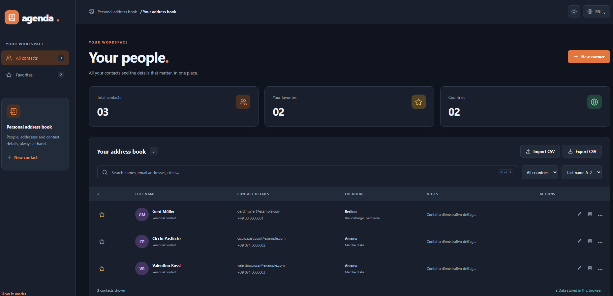
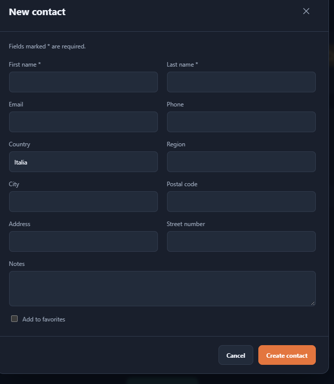
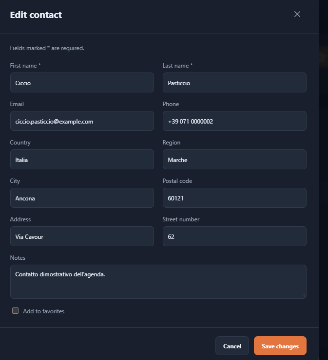

# AgendApp

A responsive personal address book built with JavaScript, CSS and Vite. Manage contacts, search your directory and create CSV backups. The interface supports English and Italian, with dark mode enabled by default.

## Contents

- [Repository Structure](#repository-structure)
- [Features](#features)
- [Screenshots](#screenshots)
- [Requirements](#requirements)
- [Installation](#installation)
- [Usage](#usage)
- [Contact validation](#contact-validation)
- [CSV import and export](#csv-import-and-export)
- [Storage and backups](#storage-and-backups)
- [Tests and build](#tests-and-build)
- [Troubleshooting](#troubleshooting)
- [License](#license)

## Repository Structure

```text
AgendApp/
|-- docs/screenshots/          # Application screenshots
|-- examples/
|   `-- agenda-2026-10-12.csv   # Sample exported CSV
|-- public/favicon.svg        # Application icon
|-- src/
|   |-- contacts.js           # Shared validation, CSV handling and search
|   |-- translations.js       # English and Italian interface text
|   |-- main.js               # Interface and contact operations
|   `-- styles.css            # Themes and responsive layout
|-- tests/contacts.test.js     # Automated tests
|-- .gitignore
|-- index.html                # HTML entry point
|-- LICENSE
|-- package-lock.json         # Dependency lockfile
|-- package.json              # Dependencies and npm commands
|-- README.md
`-- vite.config.js            # Vite configuration
```

## Features

- Create, edit and delete contacts, with confirmation before deletion.
- Search across contact fields without case or accent sensitivity.
- Favorites, country filters and sorting by last name or city.
- English and Italian interface, with saved language and theme preferences.
- Shared contact validation for creation, editing and CSV import.
- CSV import preview with duplicate detection and optional updates.
- Export the currently displayed contacts to CSV.
- Synchronize contacts across tabs of the same browser.

## Screenshots

The screenshots illustrate the interface. The import preview also includes the validation and optional update controls described below.







## Requirements

- Node.js 22.12 or later and npm.
- A modern browser such as Chrome, Firefox, Edge or Safari.

## Installation

Open a terminal in the project directory, where `package.json` is located. From Development:

```powershell
cd ".\Web Apps\AgendApp"
npm install
npm run dev
```

Open the local address printed by Vite. Keep the terminal running while using the app and press `Ctrl+C` to stop it. Do not open `index.html` directly.

## Usage

The first launch uses English and dark mode. Existing saved language preferences take precedence. Use the language button to switch between `EN` and `IT`, and the sun/moon button to change the theme.

Select **New contact** to add a contact. Use the row actions to edit, delete or view contact details, and the star button to manage favorites. Search or filter the directory to narrow the displayed contacts; `Ctrl+K` / `Cmd+K` focuses the search field.

## Contact validation

First and last names are required. Email and phone are optional, but filled fields must pass the same checks when creating, editing or importing contacts:

- **Email:** a valid email format.
- **Phone:** 10–15 total digits, including any international prefix, with an optional leading `+`, spaces, parentheses and hyphens. Formatting characters do not count toward the digit total.
- **Field length:** up to 254 characters for regular fields and 2,000 for notes.

Errors appear inside the contact form without clearing the entered values. These checks validate formatting, not whether an email address or phone number exists.

Manual entry detects possible duplicates by email, normalized phone number or first and last names. You can explicitly choose **Save anyway** for a valid contact.

## CSV import and export

### Import

Select **Import CSV** and choose a UTF-8 `.csv` file up to 5 MB, using `;` or `,` as its separator. Start with the [sample exported CSV](examples/agenda-2026-10-12.csv) to see the supported format.

Headers must match the English or Italian export field names. First and last name columns are required; other supported columns are optional. Unknown or repeated columns, malformed quoting, inconsistent column counts and invalid UTF-8 cause the entire file to be rejected. Files without a `.csv` extension are also rejected.

The preview shows new contacts, duplicates and invalid rows. Expand the excluded-row details to see the row numbers and reasons. Invalid contacts are skipped while valid new contacts can still be imported.

Duplicates are skipped by default, including repeats within the file. To update existing contacts, explicitly select **Update existing contacts** before confirming. Updates replace the supplied contact data, including empty values and omitted optional fields, while preserving IDs and favorites. Matches involving multiple existing contacts and further rows targeting the same contact remain excluded.

After confirmation, the result reports new contacts imported, contacts updated, duplicates skipped and invalid rows. A file containing only duplicates imports no new contacts unless you choose to update existing records. An empty catalog file also reports that no contacts were imported.

### Export

Select **Export CSV** to download the currently displayed contacts, respecting the active search, country filter and favorites view. Headers follow the selected interface language.

Exports use UTF-8 with a BOM, semicolon separators and quoted fields. Values that could be interpreted as spreadsheet formulas are protected with a leading apostrophe; the importer removes this protection when reading an exported file. Contact IDs and favorite flags are not included in CSV exports.

## Storage and backups

Contacts are stored in browser `localStorage` under `agenda.contacts.v1`. Language and theme use `agenda.language.v1` and `agenda.theme.v1`.

The app has no backend or database. Contacts are not sent to a server and do not synchronize across devices. Clearing site data can delete your contacts, so export CSV backups regularly. The app displays a warning if browser storage is unavailable.

Duplicate detection can produce false positives for people sharing the same name, and differently formatted international phone numbers may not match automatically.

## Tests and build

| Command | Purpose |
| --- | --- |
| `npm install` | Install dependencies. |
| `npm run dev` | Start the development server. |
| `npm test` | Run the automated Node.js tests. |
| `npm run build` | Generate production files in `dist/`. |
| `npm run preview` | Preview the generated build locally. |

```sh
npm test
npm run build
npm run preview
```

Tests cover searching, sorting, model validation, CSV round trips, formula protection, contact validation, duplicate detection and optional import updates. Publish the contents of `dist/` to static hosting; preview does not publish the app. Rebuild after source changes to update the preview.

## Troubleshooting

| Problem | Check |
| --- | --- |
| npm cannot find `package.json` | Run commands from the project directory. |
| `vite` is not recognized | Complete `npm install` before starting the app. |
| A contact cannot be saved | Check the validation messages inside the form. |
| A CSV is rejected | Check the extension, encoding, size, headers and structure. |
| No new contacts are imported | Review the duplicate and invalid-row counts. |
| The interface remains Italian | Switch to `EN`; the browser retains an existing language preference. |

## License

See [LICENSE](LICENSE) for the project's MIT license.
